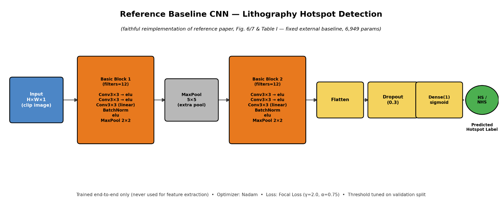
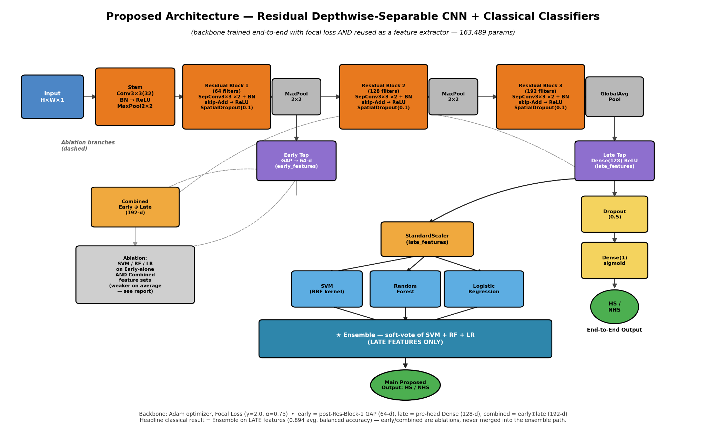

# CNN Deep Features with Classical Machine Learning for Lithography Hotspot Detection

This repository contains the experiment notebook, processed result tables, figures, configuration files, and supporting materials for evaluating CNN-based lithography hotspot detection on the ICCAD-12 benchmark suite.

## Overview

**Research question:** How do CNN backbone choice, training loss, feature depth, and classical machine-learning classifiers affect lithography hotspot detection compared with end-to-end CNN classification?

The experiments evaluate five ICCAD-12 benchmarks independently. They compare a lightweight reference CNN with a residual depthwise-separable CNN and investigate binary cross-entropy (BCE) and focal loss, CNN feature representations, and classical classification heads.

The planned experiment grid contains five benchmarks, two backbones, two loss functions, and five random seeds (100 benchmark-level run configurations).

The current end-to-end results favour the reference CNN on average balanced accuracy. The classical-classifier experiments provide additional comparisons across benchmarks and feature configurations; the results do not show one approach to be universally superior.

## Repository Structure

```text
.
├── cnn_deep_features_with_classical_ml.ipynb
├── README.md
├── RELEASE_MANIFEST.json
├── .gitignore
├── outputs/
│   ├── config.json
│   └──  README_reproducibility.md
├── results/
│   ├── tables/
│   └── figures/
├── cnn_deep_features_with_classical_ml.pptx
└── report/
    └── figures/
        ├── baseline_architecture.png
        └── proposed_architecture.png
```

The notebook is the main entry point. Processed CSV tables and figures are stored under `results/`; configuration and run notes are under `outputs/`. Architecture diagrams used in the report are under `report/figures/`.

## Dataset

The project evaluates five ICCAD-12 lithography hotspot benchmarks as separate binary classification tasks: hotspot (HS) versus non-hotspot (NHS). The primary experiments do not merge the benchmarks into one dataset.

The workflow uses training, validation, and held-out test data. Model settings and decision thresholds are selected using validation data; final reported test metrics are calculated on the held-out test split.

The dataset itself is not included in this repository or the raw-results archive. Configure the dataset path in the notebook for runs that require image data.

## Models

### Reference CNN



The reference model is a compact CNN with two convolutional blocks, batch normalization, ELU activations, max pooling, flattening, dropout, and a sigmoid output. The saved experiment configuration reports **6,949 trainable parameters**.

This model is evaluated as an end-to-end baseline.

### Proposed CNN



The proposed backbone consists of a stem followed by three residual depthwise-separable convolution blocks with 64, 128, and 192 filters. Batch normalization and spatial dropout are also used. The saved experiment configuration reports **163,489 parameters**.

The feature-extraction experiments evaluate these representations:

- **Early features:** 64-dimensional representation after the first residual block.
- **Late features:** 128-dimensional representation used before the classification head.
- **Combined features:** concatenation of early and late representations, giving 192 dimensions.

### Classical classifiers

The extracted representations are evaluated with:

- **SVM:** RBF-kernel support vector machine.
- **Random Forest:** tree-ensemble classifier.
- **Logistic Regression:** linear probabilistic classifier.
- **Decision Tree:** single-tree classifier.
- **Ensemble:** soft-voting combination of SVM, Random Forest, and Logistic Regression, evaluated on late features.

The ensemble is a separate late-feature experiment; it does not combine the early and combined feature settings.

## Experimental Method

### Backbone and loss

Both CNN backbones are evaluated with binary cross-entropy and focal loss. The focal-loss configuration uses \(\gamma = 2.0\) and \(\alpha = 0.75\).

### Feature extraction and classification

The proposed CNN is trained end-to-end and used to extract early, late, and combined feature representations. Classical classifiers are then fitted to these representations. This enables comparison between direct CNN classification and a two-stage feature-extraction pipeline.

### Validation and test protocol

Hyperparameters and decision thresholds are selected using validation data. Test data are reserved for final evaluation and should not be used to select model settings or thresholds.

The saved analysis includes metrics such as balanced accuracy, precision, recall, F1, specificity, false-alarm counts, ROC-AUC, and average precision where available. Additional analyses include confidence intervals, statistical comparisons, calibration, threshold sensitivity, and compute cost.

Results are collected over five seeds. GPU nondeterminism and differences in software or hardware environments may prevent exact bitwise reproduction.

## Results Summary

### End-to-end CNNs

Average balanced accuracy across the five benchmarks, reported as mean ± standard deviation over five seeds:

| Method | Average balanced accuracy |
|---|---:|
| Reference CNN, end-to-end with focal loss | **0.924 ± 0.019** |
| Proposed CNN, end-to-end with focal loss | 0.886 ± 0.014 |

In these results, the reference CNN has higher average balanced accuracy. Performance of the proposed CNN varies by benchmark, making the per-benchmark results important context for the aggregate average.

### Interpreting the results

- The reference CNN provides an important baseline for the feature-extraction experiments.
- Effects of backbone, loss function, feature depth, and classifier should be interpreted using the corresponding result tables.
- Performance may vary across benchmarks, particularly where test sets are small or class distributions are imbalanced.
- Results from this experiment alone do not establish state-of-the-art performance or consistent superiority over published methods.

See `results/tables/` for per-benchmark metrics and uncertainty estimates, and `results/figures/` for visual summaries.

## Figures

The figure collection includes benchmark class distributions, balanced-accuracy comparisons, confusion matrices, calibration plots, threshold-sensitivity plots, and supplementary comparisons of method averages and backbone effects.

Architecture diagrams:

- `report/figures/baseline_architecture.png`
- `report/figures/proposed_architecture.png`

## Statistical Analysis

The available result tables include seed-level summaries, confidence intervals, paired comparisons, and Holm correction for multiple comparisons where calculated. With five seeds, the analysis has limited power to detect small effects. Repeated runs also do not remove uncertainty associated with data splits or nondeterministic operations.

Published-method results are not included in the numerical summary because benchmark and evaluation protocols may differ.

## Compute Cost

The experiment outputs include parameter counts and, where available, FLOP estimates, feature-extraction time, classifier inference latency, and training or fitting times. Latency depends on the hardware and measurement procedure used; these measurements describe the recorded setup rather than a universal runtime.

## Limitations

- The experiments use five random seeds, limiting statistical power for small differences.
- Small validation sets, especially for smaller benchmarks, can make model and threshold selection unstable.
- GPU operations may be nondeterministic, so exact bitwise reproduction is not guaranteed.
- The dataset copy used in the experiments has a provenance and benchmark-count discrepancy, which limits direct comparison with published results.
- Published methods may use different input resolutions, dataset versions, splits, thresholds, and false-alarm definitions.
- Latency measurements are specific to the recorded execution environment.
- The experiments do not establish cross-benchmark generalization.

## Raw Experiment Results

The raw experiment archive contains saved JSON metrics and NPZ prediction-score arrays used by the analysis. It is distributed separately from the repository because of its size.

Download `da3_raw.zip` from the project's GitHub Release assets. After extracting it, set the notebook's `RAW_DIR` to the extracted results directory to regenerate analysis tables and figures without retraining, provided the archive contains the runs needed by the selected analysis cells.

The processed CSV tables and figures are already included in `results/`.

## Reproducing the Experiments

1. Open `cnn_deep_features_with_classical_ml.ipynb` in a compatible Jupyter environment, such as Kaggle or Google Colab.
2. Install the packages required by the notebook.
3. Make the ICCAD-12 dataset available and configure the dataset path in the notebook.
4. Run the experiment cells in order.
5. Preserve generated JSON and NPZ outputs so that analysis can be performed from saved runs.
6. To regenerate analysis without retraining, extract `da3_raw.zip` from the GitHub Release and configure `RAW_DIR` to point to the extracted raw results.

See `outputs/config.json` for the recorded experiment configuration and `outputs/README_reproducibility.md` for additional run notes.

## Download Experiment Archives

- [Raw Experiment Results](https://github.com/YokeshGaneshBabu/cnn-deep-features-with-classical-ml/releases)
- [Tables and Figures](https://github.com/YokeshGaneshBabu/cnn-deep-features-with-classical-ml/releases)
